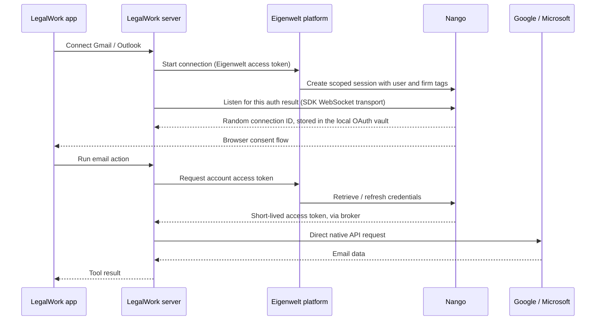

# Nango authentication and direct connectors

Microsoft connectors default to [direct sign-in using LegalWork's public desktop app](microsoft-oauth.md). Outlook Email/Calendar, OneDrive and SharePoint need no client ID entry, client secret or Eigenwelt sign-in. Saved own-app configurations and existing managed connections remain usable; reconnecting an existing connection retains its original method. The Nango setup below applies to managed connections, not the default Microsoft path.

LegalWork also offers Eigenwelt-managed sign-in through Nango, or direct authorization using the user's own OAuth app. Email, calendar and file requests run in the LegalWork server and go directly to Google or Microsoft. With managed sign-in, the Eigenwelt platform is a narrow credential broker: it never accepts email bodies, events, documents, attachments, arbitrary provider requests, Nango proxy calls, syncs or actions. Dropbox uses LegalWork's existing integration; it is not duplicated in this connector registry.

## Setup

Deploy the companion routes in `model-api/apps/platform/src/app/api/connectors/[[...path]]/route.ts`. Configure `NANGO_API_KEY` and `NANGO_CREDENTIALS_API_KEY` **only on the platform backend**, through its secret manager. Never put either key in the desktop app, an OpenCode configuration, a frontend variable or a repository.

Create these OAuth integrations in the same Nango environment as that API key:

| LegalWork connector | Default Nango integration ID | Optional platform override |
| --- | --- | --- |
| Gmail | `google-mail` | `NANGO_GMAIL_INTEGRATION_ID` |
| Outlook Email and Calendar | `outlook` | `NANGO_OUTLOOK_INTEGRATION_ID` |
| Google Calendar | `google-calendar` | `NANGO_GOOGLE_CALENDAR_INTEGRATION_ID` |
| Google Drive | `google-drive` | `NANGO_GOOGLE_DRIVE_INTEGRATION_ID` |
| OneDrive for work or school | `one-drive` | `NANGO_ONEDRIVE_INTEGRATION_ID` |
| OneDrive Personal | `one-drive-personal` | `NANGO_ONEDRIVE_PERSONAL_INTEGRATION_ID` |
| SharePoint | `sharepoint-online` | `NANGO_SHAREPOINT_INTEGRATION_ID` |

Use Nango's shared OAuth apps or your own apps. The LegalWork connector code is identical in either case. A later app change may require users to reconnect. Keep Nango syncs and functions disabled: LegalWork does not use them. Nango's public `POST /integrations/quickstart` endpoint configures a shared app without handling its client secret. Set `forward_webhooks: false` for these auth-only integrations. All listed providers offered shared apps in the dashboard on 2026-10-13. The dashboard labels them for testing, while the [auth guide](https://nango.dev/docs/guides/auth/auth-guide#oauth-developer-apps) says they also work in production and recommends using your own. Shared scopes are fixed and apps can be revoked. Microsoft tenant administrators may need to approve access.

Use two custom-scoped runtime keys, created in Environment Settings → API Keys. `NANGO_API_KEY` has `environment:integrations:list`, `environment:connect_sessions:write`, `environment:connections:read` and `environment:connections:delete`. `NANGO_CREDENTIALS_API_KEY` has only `environment:connections:read_credentials`. Neither key may have `environment:connections:list`, `environment:connections:list_credentials`, any wildcard, proxy, function, sync or environment-administration permissions. Do not use the default full-access key at runtime. The catalog's default response reads local configuration; integration availability is verified only on explicit Connect/Reconnect.

The desktop learns Nango's randomly generated connection ID through the same WebSocket auth-result transport used by Nango's Frontend SDK. No collection lookup or backend webhook/database is used. Nango connection capabilities and status are stored in the existing `storage-oauth.vault`, alongside file-storage OAuth grants, under separate keys scoped to the platform origin, user, firm and provider. Settings and agents receive independent local handles. The shared vault uses AES-256-GCM, atomic writes and serialized updates. It uses `LEGALWORK_ENCRYPTION_KEY` when configured; otherwise its generated 32-byte key is stored in `storage-oauth.vault.key`. Both files have Unix permissions `0600`. The vault sits beside `file-storage.json`, including when `LEGALWORK_STORAGE_STORE` overrides that file's location. The local key file must be protected with the rest of the user's profile; this is the existing OAuth vault's encryption scheme, not OS Keychain encryption.

Legacy SQLite records are imported into the vault and erased from SQLite after the encrypted write succeeds. Old plaintext connection IDs get new local handles; previously encrypted records keep their local handles. Electron supplies a read-only `safeStorage` decryption hook solely for that older encrypted format. A failed migration leaves the original record intact. New sign-ins, status updates and disconnects never write through `safeStorage`, and standalone hosts need no credential-storage hook for normal operation. Nango access tokens remain in memory; refresh tokens remain with Nango.

All broker operations that contain a connection capability use fixed POST paths and put the capability in the body, so ordinary access logs never contain it. Model-api stores no connection IDs and does not log request bodies or upstream credential payloads. Status/ownership checks use the metadata-only key and cannot trigger a credential refresh; token retrieval uses the separate credential key and verifies ownership again before returning an access token. Revoked accounts can still be inspected and disconnected. Refresh tokens remain with Nango.

These limits reduce enumeration after a runtime-key leak. They do not prevent a Nango administrator with broader credentials from enumerating accounts. The broker still sees the connection ID and access token during credential retrieval, and Nango controls the storage encryption keys. This architecture does not provide a guarantee that Eigenwelt or Nango cannot access customer accounts.

For managed sign-in, users sign in through Settings → Account, then open Settings → Integrations → Local → Connectors for email/calendar, or Local → File Storage for Google Drive/OneDrive/SharePoint, then choose a service → Connect. Consent opens in their normal browser. Nango connections belong to the authenticated Eigenwelt user **and** firm and are usable across that user's workspaces. Another platform user or firm cannot retrieve, reconnect or remove them. Direct collaborator and viewer API calls cannot manage or use the owner's accounts. The owner's managed engine receives a separate, process-local connector execution capability; it does not receive a host/admin token. When a worker runs an agent, that agent acts under the worker owner's connected accounts.

### Separate Outlook activation

Outlook Email and Outlook Calendar share one OAuth account but have separate activation. Completing Connect/Reconnect activates only the chosen connector. The other dialog offers **Activate Outlook Email/Calendar**, which reuses the saved account without another sign-in or Nango request. Deactivating one blocks its tools while retaining the shared account and the other connector's activation. Disconnecting the account removes both. Activation is bound to the public local account handle in `connector-settings.json`; a different account does not inherit it. Existing shared accounts without an activation preference stay saved and require a manual activation choice. The grid reflects each connector's own activation and account health. The owner-only `PUT /connectors/:connectorId/activation` API validates the saved account locally. Inactive tools fail before fetching credentials or content, and activation is checked again before provider requests and token retries. Write switches remain independent and do not activate a connector.

### Using your own OAuth app without an Eigenwelt account

Choose **Use your own OAuth app** in a connector's dialog. This is the default when the user is signed out. Enter the client ID, save the app details, and connect. While signed out, this path makes no connector requests to Nango or the Eigenwelt platform. The desktop signs in and refreshes tokens directly with the provider, using PKCE and a state-checked callback bound to `127.0.0.1:53683`. The browser and LegalWork server must run on the same machine for this loopback flow.

- **Google:** Create a Desktop app OAuth client and enable Gmail, Calendar or Drive APIs as appropriate. An optional installed-app client secret can be supplied. The redirect URI is `http://127.0.0.1:53683/callback`. The Google consent screen and app access restrictions still apply. See [Google's installed-app OAuth guide](https://developers.google.com/identity/protocols/oauth2/native-app).
- **Microsoft:** Create a Mobile and desktop application registration. Register `http://localhost:53683/callback` for that platform and use its client ID. A client secret is not used. The tenant defaults to `common`, or `consumers` for OneDrive Personal; a tenant ID or domain can be supplied for an organization. See [Microsoft's authorization-code flow](https://learn.microsoft.com/en-us/entra/identity-platform/v2-oauth2-auth-code-flow) and [localhost redirect rules](https://learn.microsoft.com/en-us/entra/identity-platform/reply-url).

Each connector dialog has **Allow write access**, off by default. It controls all mutations for that connector: Gmail/Outlook Email drafts and sending, Google/Outlook Calendar events, or storage uploads, file replacement and folder creation. Outlook Email and Outlook Calendar have independent switches despite sharing one connection. Preferences persist in `connector-settings.json` beside the OAuth vault, with `0600` file permissions. The old global boolean format grants no individual write access; missing preferences default off. The owner-only `GET/PUT /connectors/:connectorId/settings` API never contacts Nango. Agent discovery includes an effective per-connector `nativeConnectorWriteAccess` map. The dispatcher checks the setting before authentication; the trusted request layer checks it immediately before each provider mutation, including a rejected-token retry. Turning a switch off blocks unsent LegalWork writes without revoking already granted provider permissions. Read-only servers override every switch and cannot change them.

Own-app consent requests read scopes unless that connector's switch is enabled. Gmail adds composition and sending; Google Calendar adds event writes; Google Drive requests full `drive` rather than `drive.readonly` so arbitrary accessible uploaded files can be replaced. OneDrive and SharePoint use delegated `Files.ReadWrite.All`, with site read permissions for SharePoint. Write-enabled Outlook Email also requests Mail.Send. Older own-app mail grants require reconnecting before sending even if they already allow draft creation. Outlook consent requests the union of independently enabled mail/calendar writes, keeping a disabled sibling's scope read-only. Microsoft tenant admin consent and Google app verification may be required. Each new grant records exactly which connectors requested write permissions. Enabling a switch does not widen existing grants: reads remain available, but attempted writes require reconnection until authorized. Legacy storage grants are treated as read-only even when their old `readOnly` field was false; legacy writable mail/calendar grants remain recognized. Reconnect tokens use a distinct staged vault key, so cancelling an upgrade preserves the active grant; successful activation replaces it and removes the old token record. Nango shared app scopes remain fixed; provider permission errors explain reconnecting with a suitable own OAuth app rather than promising shared scopes can expand.

Own-app client secrets and OAuth access/refresh tokens are encrypted in the same `storage-oauth.vault`. API responses reveal only public client details and a saved-secret flag. Grants are scoped to the connector, app revision and local account handle, owned by the LegalWork server owner, and usable across that server's workspaces regardless of Eigenwelt sign-in. Changing app details invalidates prior grants and cancels pending consent; disconnect waits for in-flight refresh before erasing its grant. Removing the app clears its local connections and credentials while preserving other vault entries. Nango connections remain separately scoped to their Eigenwelt user and firm.

OneDrive Personal uses Microsoft Graph with own-app credentials. Existing Nango OneDrive Personal connections retain their native OneDrive API path.

### When LegalWork contacts Nango

Startup, browsing settings or the connector grid, opening an unused connector, and calling an unused connector's agent tools do not discover accounts through Nango. The platform's default catalog reads its own configuration only. The local server checks its saved Nango entries in the OAuth vault, scoped to the platform origin, Eigenwelt user and firm, before any lookup of a known connection or token request. Nango entries contain connection capabilities and status, never OAuth tokens or provider content. Settings and agents receive local handles only. On a new installation, cloud accounts are not automatically discovered; the user chooses Connect to authorize that installation.

Nango requests occur when the user explicitly starts Connect/Reconnect (integration availability, sign-in session and a local auth-result WebSocket), when an already connected provider's status or credentials are needed, or when removing a connected account. A cancelled or expired flow does not activate background discovery. Disconnecting the last account stops subsequent lookups for that provider. Accounts needing reconnect use their saved local status until the user starts reconnecting. Outlook Email and Calendar share one local record and one status lookup. The manual operator smoke-check script also contacts Nango when explicitly run; it is not part of normal application startup.

Users with no connected Nango accounts generate no Nango requests. Own-app OAuth also works while signed out, with no connector requests to Nango or the Eigenwelt platform. LegalWork can still call its local server and the Eigenwelt API for configuration, authentication and other product features. Nango connected-account requests send authentication credentials and connection ownership metadata (user/firm/integration/connection IDs), never emails, calendar contents, documents or attachments.

Connector dialogs load only their selected provider. Recent status metadata is shared in memory for 30 seconds across settings reads, workspaces and the two Outlook connectors; concurrent checks share one request. Changed saved accounts or Eigenwelt ownership use a separate cache entry. The dialog's Refresh button bypasses the completed cache, and sign-in completion verifies the account again. Access-token retrieval always checks ownership through the broker and does not use this metadata cache. The platform counts POST status requests as reads; POST keeps private connection identifiers out of URLs and access logs.

The account created by the research test has no LegalWork ownership tags and is deliberately not imported automatically. Connect once through LegalWork to associate it with the correct user and firm.

## Actions

All connectors use the existing `legalwork_extension_list_actions` / `legalwork_extension_call` tools. Email actions are `status`, `test_connection`, `list_messages`, `get_message`, `get_attachment`, `create_draft` and `send_draft`. Calendar actions are `status`, `test_connection`, `list_calendars`, `list_events`, `get_event` and `create_event`; Google Calendar also offers `update_event`. Google create/update cards support optional `googleMeet`. Creating an event never adds attendees or sends invitations. Time ranges use ISO timestamps with offsets. All-day end dates are exclusive.

Google Drive, OneDrive for work or school, OneDrive Personal and SharePoint are configured in the existing **File Storage** tab. Saved accounts automatically appear as Memory Drive roots for the server owner; SharePoint requires selecting a document library before its view appears. Folder/library views reuse the existing Nango or own-OAuth account and never create a second sign-in. Saved connector accounts are compatible without a credential migration. Box, Dropbox, SMB, WebDAV, S3, Azure, GCS, SFTP and FTP continue using their existing adapters.

The common `storage_*` agent tools and Memory Drive browse, native search, checkout, editor/local copy, streaming uploads/downloads, copy/move, rename/delete and project-folder links use direct Google/Microsoft StorageAdapters. Google paths include stable native IDs so duplicate names remain separate; resolving a plain duplicate name rejects ambiguity. Project references retain native folder and account/drive identities, recheck containment and reject folders moved outside their configured root. Personal native sources stay owner-only through ordinary storage and linked-project routes. The owner's managed engine uses its existing process-local connector capability; ordinary collaborator/viewer tokens cannot access these sources or promote them to shared team storage.

Google Docs, Sheets and Slides open as DOCX, XLSX and PPTX exports. These working copies can be edited and saved separately; exported bytes cannot overwrite the native Google document, and cross-source moves cannot delete it after exporting. Uploaded files use conditional versions for replacement. Google resumable uploads and streamed downloads avoid the former 5 MB upload/20 MB download connector limits. Microsoft creates above 250 MB use bounded upload-session chunks; safe conditional replacement uses its content API up to 250 MB and asks for a new filename above that size. Inline responses retain the common storage size bound. Provider limits, export-size limits and account-granted scopes still apply.

Provider-specific extras remain `status`, `test_connection`, `get_file`, `download_file`, OneDrive `list_drives`, and SharePoint `list_sites`/`list_drives`. The alternate Google PDF/DOCX/XLSX/PPTX/TXT/CSV export action retains its bounded base64 interface. Legacy file list/upload/update/folder calls remain compatible but are no longer advertised alongside common storage tools. Microsoft signed transfer URLs stay private and receive no OAuth token. Settings and root polling read saved local account metadata without Nango status/token calls; explicit refresh/connection actions or actual source access perform account/credential requests.

Each connector supports one connected account in the current owner context, across managed and own-app sign-in. Once connected, its dialog offers reconnect, test and disconnect; changing the account or sign-in method requires disconnecting first. New connection admission reads saved metadata locally, and concurrent sign-in flows share one slot across both methods and the Outlook Email/Calendar pair. Legacy extra accounts are preserved for manual disconnection in settings; tool use is blocked until only one remains. Tools automatically use the sole account, with `connectionId` retained only for compatibility. Signed-out managed accounts remain unavailable, and accounts scoped to other Eigenwelt users or firms are never inspected.

Outlook Email and Outlook Calendar share the same connection: reconnecting or disconnecting either affects both. Their write switches remain independent. The calendar connector verifies its own calendar scopes instead of inferring them from successful email access. Existing mail connections may require reconnecting to grant calendar access. There is no automatic import into LegalWork's project calendar; calendar reads are native agent actions. File accounts use the common File Storage system as described above. Results include pagination cursors. Draft creation does not send email. File attachment downloads are limited to 5 MB.

Local email and basic new-event preparation need no token; event updates and requested Meet preparation read provider metadata. Before a provider action, the server gets an access token, retries a rejected token once after a forced refresh, and reports revoked connections as requiring reconnection. It does not automatically retry ambiguous failed writes. Tokens are excluded from app responses, tool results and errors. Nango access tokens stay in process memory; own-app OAuth grants are saved in the encrypted local vault. All outbound auth and provider requests reject redirects. Microsoft content downloads use the metadata-provided URL instead of following a redirect. Microsoft pagination URLs must resume the same native resource endpoint.

## Shared email and calendar cards

The connectors reuse the editable email and calendar cards from PR #265. Connector `create_draft` and `create_event` actions prepare a local project draft bound to the selected account (and calendar). Preparation needs no remote request unless Google Meet was requested, which checks calendar capabilities. The user edits the card, then chooses **Save draft**, **Send**, or **Add to calendar**. After a provider write, **Open in Gmail/Outlook/Google Calendar** opens the saved provider item; the card cannot silently create another compose window. `.eml` and `.ics` export and the separate LegalWork calendar button remain available for new events.

Google `update_event` reads the selected event and its calendar capabilities, then prepares an update card with the original details, guests, conference and provider version. It accepts a specific recurring occurrence; series masters and special event types must be edited in Google Calendar. **Update in Google Calendar** sends only changed fields using [PATCH semantics](https://developers.google.com/workspace/calendar/api/v3/reference/events/patch), with an [If-Match ETag](https://developers.google.com/workspace/calendar/api/guides/version-resources). A changed provider version requires a new review card. Attendees, organizer, recurrence, and other untouched fields remain intact; guests cannot be edited here and `sendUpdates=none` disables calendar notifications.

Google Meet uses Calendar API conference support and the existing calendar event scopes; no separate Meet integration is needed. The selected calendar must allow `hangoutsMeet`. Each card persists one unique conference request ID and sends it once on review approval. Existing conference links stay intact when no conference change was requested. The card distinguishes event save success from pending or failed conference generation and provides **Refresh Meet status**, which only reads the saved event. Event reads also expose conference status and links. No remote conference icon is loaded, and uncertain provider writes cannot be automatically retried.

Email supports MIME text, HTML, Reply-To, Cc/Bcc and snapshotted attachments using the shared EML renderer. Gmail uploads allow 25 MB of rendered MIME; Outlook allows 3 MB to stay within its base64 request size. A hash detects changes to the local EML before upload. Send first saves an unsaved preview, checks that the provider draft has not changed, and sends it through Gmail drafts.send or Microsoft Graph messages/{id}/send. The separate `send_draft` extension action takes a local draft ID and latest revision and is intended only for an explicit user instruction to send. All these writes require the bound connector to remain active with write access enabled. Outlook needs Mail.Send; fixed shared-app scopes must support it or a user must reconnect with their own app. Provider permission failures are surfaced without escalating permissions.

Owner-only `POST /workspace/:workspaceId/connector-drafts/:kind/:draftId/deliver` handles card writes. Targets are preserved through local edits, and a new account never inherits an existing draft's target. Writes use the latest local revision under the same artifact locks as draft edits. Completed handoffs freeze the local snapshot; subsequent edits happen in the provider app or a new draft. Sending is separate from saving, and concurrent or repeated clicks cannot send twice. An ambiguous failure leaves a persistent uncertain state and requires checking the provider app rather than automatically retrying. Provider mail and event contents go directly from the LegalWork server to Google/Microsoft. Calendar entries preserve all-day dates, timed instants, time zones and reminders. New entries exclude guests; Google updates preserve existing guests without adding invitations.

For visual verification with fake providers, run `LEGALWORK_CONNECTOR_PREVIEW_DRAFTS=1 pnpm --filter legalwork-server exec bun scripts/connector-preview.ts`, then open `/connectors-preview.html?drafts=1` on the app dev server. It uses the real cards and routes with simulated provider writes, never real mail or calendar data.

## Adding another connector

1. Configure its OAuth integration in Nango. Add its provider and integration mapping to the platform's `nango-connectors.ts` registry.
2. Add its name, icon, native API origin and description/prompt translation keys to `packages/types/src/connectors.ts`. The settings panel and extension listing use this registry automatically.
3. Implement its native API adapter under `apps/server/src/connectors/` and register its own actions and input schemas in `connectors/index.ts`. Mark each mutating action with `writes: true`; the shared dispatcher enforces read-only mode. Non-mail connectors have their own action sets. Do not use Nango tools or proxy calls; they would route content through Nango.
4. Add tests for ownership, direct API destinations, refresh failure and each consequential write. Run both repositories' typechecks and connector tests.

## Verification and limits

### Bundled provider icons

Connector cards, detail dialogs and connection settings resolve their brand icons from `apps/app/public/ext-<slug>.svg`. Vite copies these into the renderer build, and Electron ships that directory as `app-dist`. Relative paths work in packaged builds. No icon CDN, Nango dashboard or provider website is contacted to render these icons.

Gmail, Google Calendar, Google Drive, Outlook and SharePoint SVGs are vendored from [Nango's provider logos](https://github.com/NangoHQ/nango/tree/6ffe9af14735a9c11f0ca69321c42d5b70ed618f/packages/webapp/public/images/template-logos), at commit `6ffe9af14735a9c11f0ca69321c42d5b70ed618f`, using files `google-mail.svg`, `google-calendar.svg`, `google-drive.svg`, `outlook.svg` and `sharepoint-online.svg`. Both OneDrive connectors share [Microsoft's OneDrive product icon](https://www.microsoft.com/content/dam/microsoft/bade/images/icons/en-us/m365-app-icons-fy26/OneDrive-Icon-FY26.svg), sourced from its OneDrive product page; Nango's `one-drive.svg` contained an Outlook mark. Dropbox reuses the existing bundled Simple Icons mark (CC0-1.0). Transparent padding was trimmed and a viewBox was added for scaling. Logos render without a surrounding frame at 24 px in the connector grid and 32 px in the detail modal. The upstream license is bundled at `apps/app/public/third-party/nango-provider-icons/LICENSE.txt`. The vendored SVGs have no external image, font, stylesheet or script dependencies. Provider marks remain their respective owners' trademarks.

The earlier live Gmail test retrieved a token, made a direct Gmail request, forced a refresh and repeated the direct request successfully. Outlook needs a real Microsoft account test. Unit and HTTP tests exercise both adapters and the broker without sending email or creating real drafts.

For a read-only live check of the new Gmail adapter, run `pnpm --filter legalwork-server exec bun scripts/nango-gmail-smoke.ts /path/to/private/credential-key-file /path/to/private/known-connection.json`. The private JSON must contain `connectionId` and `integrationId`; the script never enumerates connections. It requests only the Gmail profile, before and after refresh, and prints statuses without identifiers or tokens. For the browser fixture, run `pnpm --filter legalwork-server exec bun scripts/connector-preview.ts` and the app's Vite server, then visit `/connectors-preview.html`. The fixture uses simulated accounts and the real LegalWork API routes and settings component.

Nango's shared Gmail app grants fixed full-mail permissions; LegalWork exposes reading, reviewed draft creation and explicit sending. Nango automatically reads Gmail profile metadata during connection setup. Email bodies and attachments are not sent to Nango by this implementation. Shared OAuth apps may be revoked or restricted independently of LegalWork; reconnecting and replacing the integration configuration handle that operational dependency. A successful test establishes current behavior, not permanent provider availability.

The code must be deployed with the platform secret before these connectors work in distributed desktop builds. No Nango secret is bundled and there is no local master-key fallback.

Storage UI fixture: run `LEGALWORK_CONNECTOR_PREVIEW_STORAGE=1 pnpm --filter legalwork-server exec bun scripts/connector-preview.ts` and open `/connectors-preview.html?storage` on the app Vite server. Its accounts, documents, sites and libraries are synthetic; storage views and root browsing exercise the real server routes.

## Team storage authorization

Google/Microsoft storage also supports explicit team entries; see
[Team storage](team-storage.md#google-and-microsoft-team-storage). Member mode
reuses each user's one personal account. Shared-account mode uses an encrypted
platform-side grant and desktop-only token retrieval. Personal account isolation
and single-account admission remain in place; sharing a location does not
automatically expose the owner's personal connector tools.
