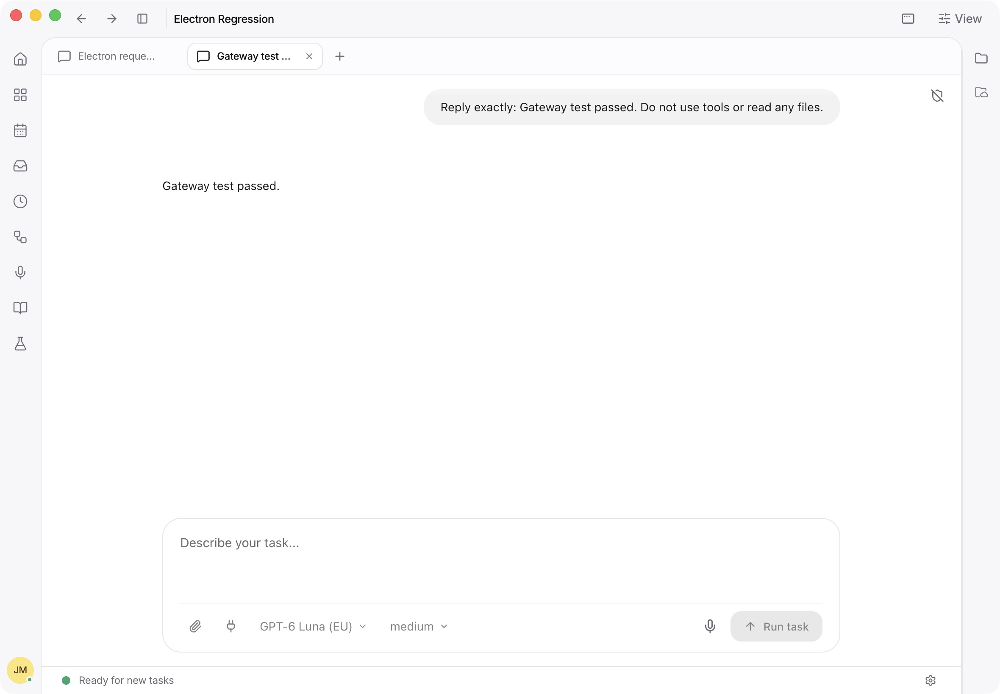

# Real Electron dev-app verification — 23 October 2026

Status: **DONE_WITH_CONCERNS**. The tested core flows pass in the real development
application. Five previously recorded suite failures remain. External services
and every product feature have not been certified by this check.

## Environment

- Actual `pnpm dev:electron` launcher, `electron/main.mjs`, production preload,
  React app served by Vite, embedded production Node server, and pinned OpenCode
  1.18.29 engine. This is not the earlier component-only browser fixture.
- Separate Electron user data, runtime databases and configuration. Eighteen
  disposable local projects and one independent remote test worker were used.
- The remote worker runs the compiled server and a separate OpenCode process and
  database. Its IPv4-mapped loopback address exercises Electron's non-loopback
  native request transport. It does not measure WAN latency.
- The initial run substituted a local OpenAI-compatible model endpoint.
  A subsequent live Eigenwelt subscription check is recorded below. Office
  installation and cloud storage were not exercised.
- The fresh checkout required staging the locked plugin SDK with
  `node apps/desktop/scripts/prepare-opencode-sdk.mjs`. Office add-in installation
  was disabled for this test profile.

## Verified in the UI

| Flow | Result |
| --- | --- |
| Project creation and onboarding | Passed |
| Custom provider discovery, save and model selection | Passed |
| Local chat creation, sending and streamed reply | Passed; reply persisted |
| Eighteen-project sidebar and project switching | Passed |
| Markdown file opening, editing and autosave | Passed; file contents verified on disk |
| Group creation and moving a chat into it | Passed |
| Group rename from a second API client | Appeared without reloading |
| Scheduled task creation, list/detail and pause | Passed; test date in 2030 and task paused |
| Review list navigation | Passed |
| Settings navigation and sandbox status | Passed without changing permissions |
| Independent remote worker connection and new chat | Passed |
| Remote prompt, native transport, stream and saved transcript | Passed |
| Full Electron restart with remote registry entries | Passed after fixing the issue below |
| Local chat, group, edited file and paused task after restart | Preserved |
| Returning from remote chat to local chat | Passed |

## Issues found and fixed

1. **Remote registry entries broke embedded startup.** `embedded.ts` attempted to
   initialize every registration as a local folder. A remote registration has no
   local path, so restart failed with `workspace path is required`. The first
   registration could also displace the primary local engine. Startup now skips
   remote folder bootstrap and selects the first local project for that engine.
   The new `embedded.test.ts` regression failed before the fix with that exact
   error and passes afterward. A full real-app restart also passes.
2. **Settings requested remote chats from the local server.** The real request
   `/workspace/rem_ws_separate_remote/sessions` returned 403 from the local
   embedded server. Settings now resolves each project's owning endpoint and
   uses its canonical workspace ID. Reopening Settings after the change made
   zero such requests; the retest recorded 228 local API requests with no failed
   requests or renderer exceptions.

The initial self-referencing remote fixture exposed the same chat through two
workspace identities, conflicting with chat ownership checks. It was replaced
with an independent worker. Its obsolete tab was closed before final checks;
associated missing-session responses are retained in the setup logs rather than
being counted as successful application behavior.

## Requests and regression checks

In one 145-second navigation sample, local group synchronization used four batch
reads and no individual per-project group-event reads. Those batch reads had a
median of 2.94 ms, maximum of 4.37 ms, and peak concurrency of one. Navigation and
visibility affect cadence, so this sample is not a minute-long idle benchmark.

One initial cold personalization read took 5,820 ms. Repeated reads took 2, 1 and
1 ms. This remains documented; the work does not promise that every cold or
file-dependent request will finish within five seconds.

Fresh validation after the two additional fixes:

| Check | Result |
| --- | --- |
| Full app suite | 1,670 pass; same 3 baseline editor failures/module errors |
| Full server suite | 2,423 pass, 49 skip; same 2 baseline failures |
| Focused startup/metadata regressions | 6 pass |
| App type check and production build | Pass |
| Server production build, including type checking | Pass |
| Desktop suite from the preceding implementation run | 383 pass, 4 skip; desktop source unchanged in this follow-up |

The prepared desktop resources/native dependencies allow some server tests that
were previously skipped to run; the suite generates conditional cases, so its
counts differ from the preceding run. The two failing server test names are
unchanged: ended-stream error handling under Bun and wiki graph filesystem
polling. The original baseline/final logs are preserved.

## Evidence

The parent workspace's `artifacts/legalwork-request-audit-20261023/real-electron-dev/`
contains `results.json`, launch/support scripts, full app/server test logs,
startup regression red/green logs, request JSONL captures, and these screenshots:

- `editor-save.png`
- `local-after-restart.png`
- `remote-chat-passed.png`

The test scripts use only disposable fixture credentials and isolated data.
The installed application and original source checkout were not replaced.

## Live Eigenwelt subscription follow-up

The actual Electron dev application was also connected to the production Eigenwelt
platform through OAuth using the existing work-browser account. The exchange and
connection save used the real server API; no production token was copied from
another installation or written to the evidence report. The platform confirmed
an **active Pro subscription** and returned nine subscription models.

In a new disposable chat, GPT-6 Luna (`eigenwelt` / `Eigenwelt Europe GPT Luna`)
returned exactly **“Gateway test passed.”** through the paid gateway. The saved
transcript records 5,178 ms from user-message creation to completed reply, including
4,992 ms for the assistant response. The model made no tool calls. The response
appeared in Electron, the transcript was retrieved successfully from the server,
and the same reply remained visible after a full application restart.

The passive renderer capture contains 847 completed local API requests across
startup, sign-in, navigation and this check, excluding intentional OAuth long-polls.
None returned HTTP errors or exceeded five seconds; median completion was 6.56 ms.
This is a mixed-workload observation, not an idle request-rate benchmark or a
production gateway latency guarantee. The stopped independent remote fixture
produced expected native connection errors and was not part of this live check.

**Open concern:** manual renderer refresh reproducibly left the native dev window
blank while its DOM remained populated and the local server continued responding.
No uncaught renderer exception was captured. A full process restart restored the
UI. Its cause and relationship to the performance changes are not established;
this follow-up does not certify refresh behavior as regression-free.

Evidence: `gateway-results.json`, `gateway-chat-passed.png`, `gateway-dev.log` and
`gateway-renderer-requests.jsonl` in the same evidence directory. This was one short
real inference, not exhaustive live-service testing.

To repeat the live check, launch the Electron dev app with an isolated development
profile, sign in to an existing Eigenwelt subscription, open a disposable project,
select a subscription model, and send `Reply exactly: Gateway test passed. Do not
use tools or read any files.` Confirm the reply, restart the entire application,
and reopen the same chat. Manual renderer refresh is the unresolved case above.
