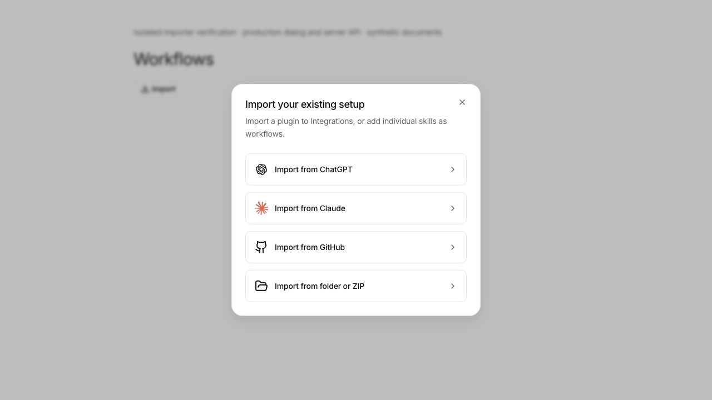
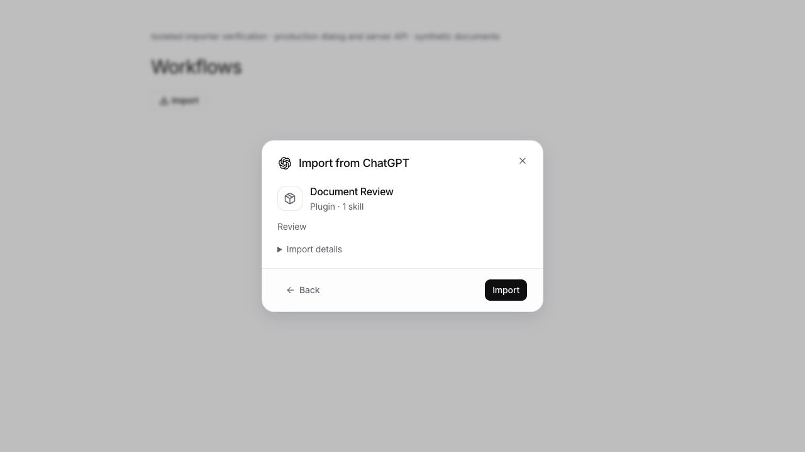
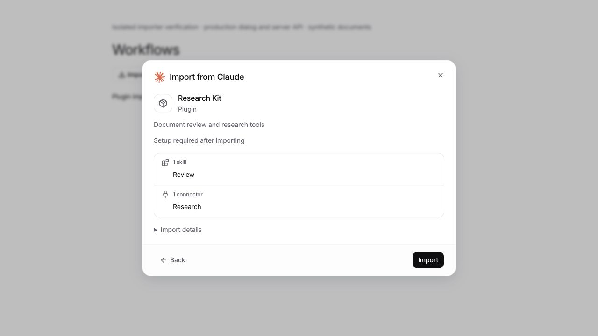

# Plugin format compatibility audit

Reviewed on 20 October 2026 against `dev` at `fb40b3ad`. This audit covers the import contract, not a claim that arbitrary instructions work identically in every host.

## Sources

- [OpenAI packaging, optional scaffolds, local marketplaces, overlays and authentication](https://developers.openai.com/plugins/build/plugins)
- [OpenAI skills](https://developers.openai.com/plugins/build/skills)
- [OpenAI's app configuration parser](https://github.com/openai/codex/blob/main/codex-rs/connectors/src/plugin_config.rs) and [loader](https://github.com/openai/codex/blob/main/codex-rs/core-plugins/src/loader.rs): a missing `apps` property defaults to an empty map; an explicit app path replaces default-file discovery.
- [Claude plugin manifest and component paths](https://code.claude.com/docs/en/plugins-reference)
- [Claude marketplace entries, precedence and source types](https://code.claude.com/docs/en/plugins/marketplace-reference)
- [Claude Cowork plugin packaging](https://claude.com/resources/guides/claude-cowork-product-guide/extending-claude-cowork-with-plugins)
- [Agent Plugins 1.0.0 specification](https://agent-plugins.org/specification), [manifest schema](https://agent-plugins.org/schemas/1.0.0/plugin.schema.json) and [connector schema](https://agent-plugins.org/schemas/1.0.0/mcp.schema.json)

## Findings and behavior

| Contract | Import behavior and regression coverage |
| --- | --- |
| Optional OpenAI `.app.json` | `{}` and `{"apps":{}}` do not block skills. Empty `null`/array scaffolds are tolerated too. Missing or malformed nonempty declarations produce a blocked review with recovery instructions, rather than throwing the old generic error before review. |
| Registered ChatGPT apps | A nonempty app map still blocks importing the whole plugin as working functionality. An app ID does not provide an endpoint, portable account grant or the original host's runtime. These dependencies are never silently discarded. |
| Explicit app-file declaration | Overrides `.app.json`, matching OpenAI's loader. An obsolete default file no longer invents an extra dependency. |
| Provider selection | The server detects Codex, Claude and portable manifests by default. Discovery remains organized by source app; folder/ZIP/repository imports do not require the user to guess the format. An explicitly format-restricted API request remains available. |
| Workflows import | Uses the shared plugin review and source chooser, including ChatGPT and Claude. Plain skill packages become workflows. Manifested or marketplace plugins retain their complete bundle and are added to Integrations, including their connectors. |
| Local marketplace entries | String paths and OpenAI `source: local` objects resolve from the marketplace root. Claude `metadata.pluginRoot` bare names are supported. Catalog imports keep local plugin roots separate, including manifest-free entries. |
| Marketplace metadata | Discovery carries the catalog reference into review and update provenance. Review reads only the chosen plugin folder plus bounded catalog metadata, rather than traversing the user's home directory. Catalog-only skills/connectors, display fields and documented Claude supplemental components survive. Relevant entry changes invalidate the reviewed digest. |
| Marketplace component precedence | Manifest-free entries supply the manifest. Claude entry display fields override plugin display fields; explicit component paths supplement the manifest under default strict mode. Conflicting `strict: false` component overrides fail with a specific error. Commands can combine path and inline forms. |
| Catalog source boundaries | Paths cannot traverse outside the catalog. Remote Git/registry/archive/command entries are not fetched or executed by catalog import. Installed copies and direct GitHub/folder/ZIP sources use the normal importer; a remote-only catalog explains this instead of showing an empty package. Supporting marketplace templates inside a plugin remain resources. |
| Portable OpenAI authentication profile | Documented `extensions.com.openai.auth` in `mcp.json` is validated separately from the closed portable core. Anonymous and API-key configurations reach the existing connection checks. Custom endpoints, client authentication and permission restrictions the engine cannot preserve produce specific exclusions. Explicit base/default scope declarations, including an empty default list, cannot silently widen permissions. |
| Host-specific behavior | Existing hook, runtime, permission, dependency and connector restrictions remain. Message channels, default `settings.json` and `output-styles/` are also disclosed when present. Import never executes source hooks, commands or install scripts. |

Timothy's private package was not available. The fixes reproduce the documented format failures without requiring it or assuming its exact contents.

## Verification

`apps/server/src/plugin-import-formats.test.ts` covers the new contracts, alongside the existing import, preparation, runtime, ownership, rollback, source archive and OAuth tests. The local marketplace regression exercises discovery → API request parsing → preview, then changes its declared dependency and checks that review becomes unsupported with a different digest.

Read-only planning ran on 66 actual installed bundles:

| Source | Ready | Setup | Partial | Unsupported | Size/file-limit rejection |
| --- | ---: | ---: | ---: | ---: | ---: |
| Claude official marketplace, 40 bundles | 10 | 10 | 1 | 19 | 0 |
| OpenAI installed bundles, 26 bundles | 3 | 0 | 0 | 22 | 1 |

Five actual packages passed prepare/review, installation, byte comparison of supporting assets, reimport, rollback and removal in an isolated database/global library: Claude **Frontend Design**, **Math Olympiad**, **Feature Dev**, and OpenAI **PDF** and **Visualize**. The comparison verified respectively 6, 24, 7, 11 and 29 supporting resource files; generated import reports were excluded. The originals were not changed or executed. `openai-templates` exceeded the existing 64 MB / 5,000-file limit.

These lifecycle checks do not establish successful sign-in to a real provider account or prove semantic portability of natural-language instructions. The existing runtime OAuth tests cover the actual engine against a controlled provider; provider account access and original-host app services remain separate requirements.

The production workflow import button and shared dialog were also exercised against a disposable real server/database with synthetic packages. The UI imported an empty-app Codex plugin and a Claude skill/connector bundle; the saved registry retained both as global plugins, with the connector waiting for credential setup. A hosted-app dependency displayed its reason and disabled Import. The temporary preview entry points were removed afterward.

Use CI's pinned Bun **1.4.2** for app unit checks. Local Bun 1.3.14 reproduces three Lexical initialization errors on both this branch and unchanged `dev`; these are runtime-specific baseline failures, not import regressions.
