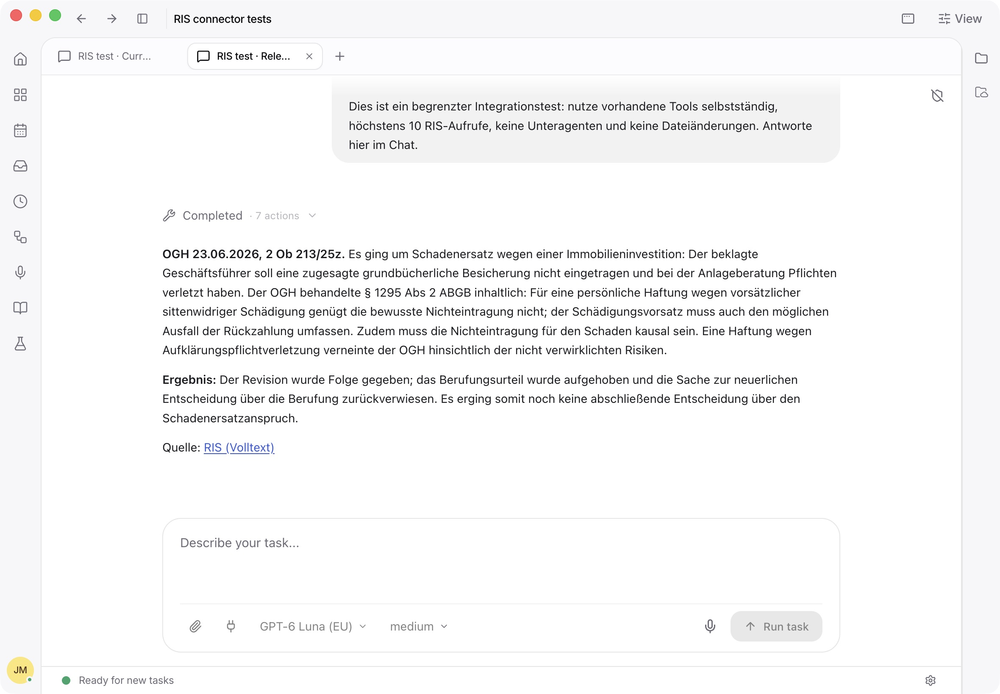

# Austrian RIS integration verification

Verified on 6 November 2026 in an isolated Electron development profile, signed in to the Eigenwelt model API. The test project was **RIS connector tests**. Requests used the real LegalWork agent, native extension dispatcher and public RIS endpoints.

The live sessions and screenshot were captured on the implementation branch. The integration was then transferred onto a clean branch from `dev`; the focused tests, builds, typecheck, translations and help validation below passed again on that PR branch.

## Agent smoke tests

Model: **GPT-6 Luna (EU)** (`Eigenwelt Europe GPT Luna`), medium reasoning. Eight agent sessions covered the following six final scenarios, including a fresh state-law run after the correction and a more focused case-law query.

| Scenario | Observed result |
| --- | --- |
| Current federal law | Read § 1295 ABGB for 6 November 2026, explained both paragraphs and linked the retrieved source. |
| Historical legislation | Read § 1 KSchG for 1 January 2020 and retained the requested date and consolidated-source caveat. |
| State law | Searched Tirol and the requested date, then read TBO 2022 § 1 by its exact document ID, `LTI40053243`. |
| Relevant OGH decision | Read the full text of OGH 23 June 2026, 2 Ob 213/25z; identified the substantive § 1295 ABGB discussion and correctly reported the remand. |
| No-result search | Searched a deliberately nonexistent law in consolidated federal law and authentic federal gazettes; reported zero results without inventing a provision or treating the search as exhaustive proof. |
| Disabled integration | Reported that no retrieval occurred, explained how to enable RIS, and did not enable it itself. RIS was re-enabled after the test. |

The initial state-law run exposed that different states can share a numeric Gesetzesnummer. The model recovered from an unrelated Burgenland result using the exact Tyrolean document ID. Record operations now require an exact state document ID, contents/neighbor queries retain the state, and state validity checks describe the specific version. The fresh agent run used the correct ID directly. A live metadata/contents/validity check also returned Tirol, 83 sections, and the expected validity dates.

The initial broad damages search selected a decision with an incidental damages reference. Court-label and relevance guidance was improved; the focused follow-up selected and read a decision substantively addressing § 1295 ABGB. Case relevance still requires review; these are bounded smoke tests.

Exact billed cost was not exposed by the engine's model catalog/session cost fields. A zero in those fields does not mean the calls were free.



## Reproduction

1. Start the Electron development app with a separate profile, connect the Eigenwelt provider, and select GPT-6 Luna (EU), medium.
2. Open **Settings > Integrations > Legal databases > Austrian RIS**, choose **Enable RIS**, then **Test connection**.
3. Ask for the current and historical provisions, specifying the dates above. Ask for a substantive OGH damages decision and require the full text, case number, date, outcome and RIS link.
4. Ask for § 1 TBO 2022 in Tirol for 6 November 2026. Inspect the action inputs and returned document identity.
5. Search an invented exact law title and check that the answer describes the actual zero-result searches.
6. Disable RIS, ask for another RIS lookup, and check that the agent explains activation without claiming a retrieval. Re-enable RIS afterwards.

## Automated validation

Use the repository's pinned Bun 1.4.4 runtime and pnpm. The following focused commands are recorded in the PR with their results:

```sh
bun test apps/server/src/ris/ris.test.ts apps/server/src/extensions/ris.test.ts apps/server/src/connectors/plugin.test.ts apps/server/src/legalwork-help.test.ts apps/server/src/org-policy.test.ts
pnpm --filter @legalwork/app exec bun test tests/ris-integration.test.tsx tests/connector-browser.test.tsx tests/connector-status-query.test.ts tests/mcp-catalog-auth.test.ts tests/composer-plugin-selection.test.ts
pnpm --filter legalwork-server build
pnpm --filter @legalwork/app typecheck
pnpm --filter @legalwork/app build
pnpm --filter @legalwork/app test:i18n
pnpm docs:check
```
