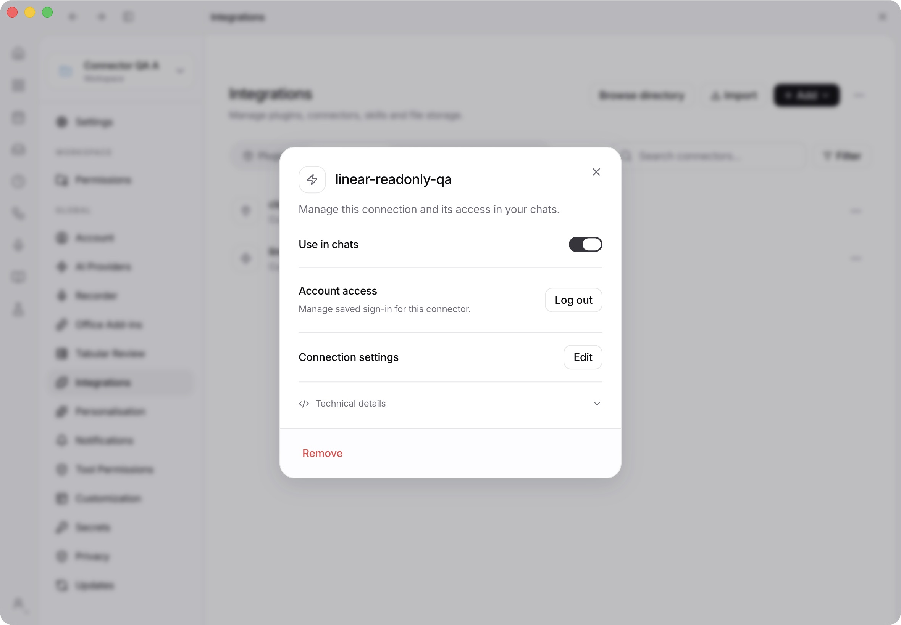
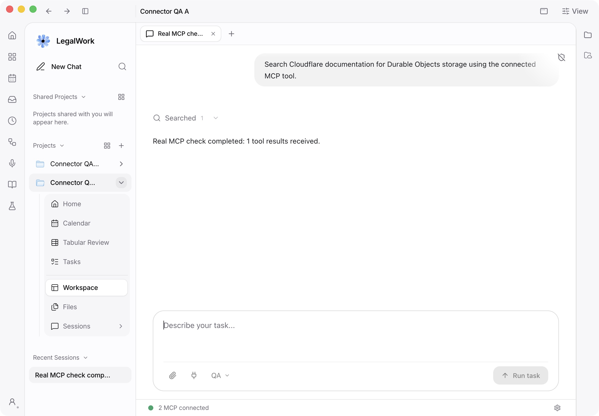

# Connector manager: migration, protocol and platform QA

## Migration hardening — 20 October 2026

The branch includes `dev` through `fb40b3ad`. Migration ownership now compares the
actual legacy credential path, preserving the conservative wait when inspection
fails. Native process tests cover an engine using the same store, another store,
paths containing spaces, symlink aliases and process exit. The macOS path reader
is built and shipped as `helpers/LegalWorkProcessInfo`; the packaged startup probe
also executes it and verifies its output contains only selected path variables.

The destination grant is persisted as staged before retiring the source. Staged
grants stay unusable across restart until retirement and activation complete.
Fault tests cover destination write failure, retirement failure, interruption
after staging, activation failure after retirement, partial multi-connector
completion, cross-profile claims and concurrent logout. Connector configuration
is never deleted by credential migration. The original entry remains when
staging or retirement fails. After retirement, recovery uses the existing vault,
without restoring potentially stale credentials into the old store.

Migration and in-flight transport recovery now return `connecting`. The UI waits
without launching another OAuth flow, emitting connected analytics or reporting
a false failure. A failed completed reconnect is still shown as failed during
its retry cooldown.

A manual upgrade using the same isolated Electron profile migrated existing
Linear, Kaneo and Fibery grants without another sign-in. Read tools succeeded
through the gateway in two projects, both before and after a normal restart
(twelve actual tool calls). The built-in Gmail account test passed and its vault
entry remained unchanged. This was direct tool coverage, not an LLM-agent run.

The first full macOS server run after hardening passed **2,462 tests**, with
72 skipped and zero failures (23,251 assertions). The final expanded suite,
packaged desktop checks and new Windows VM run are recorded in the PR’s current
validation report after completion; do not infer those results from older runs
below.

The macOS desktop build, ad-hoc signed arm64 package and isolated packaged startup
passed. The packaged SDK graph, security fuses, bundled Node, DOCX/PDF tools and
native ownership helper passed their probes. No installed application was
modified. Older native recovery fixtures now create connectors through the
server API, reject unsupported modern discovery correctly and send OAuth state
headers; they also verify the connecting status and that delayed handshakes
cannot re-enable disabled or removed connectors. CI runs these fixtures with the
shipped OpenCode binary alongside the two-engine migration test.

## Current protocol revision — 20 October 2026

The manager and gateway use official TypeScript SDK 2.3.1 and MCP 2026-07-28;
remaining SDK v1 consumers use 1.32.1. Protocol packages are mirrored into the
desktop package graph, checked by the existing packaging test. OpenCode is stock
1.18.29; this change does not patch it.

The current macOS arm64 checks use Bun 1.4.2, matching CI:

- Full server: **2,455 passed, 73 skipped**, 23,211 assertions, 299 files,
  using the ordinary `pnpm --filter legalwork-server test` timeout.
- Full app: **1,638 passed**, 108,759 assertions.
- Desktop: **263 passed, 3 skipped** in the Node test runner.
- Server and app TypeScript checks, server build, packaged dependency checks and
  importing the built manager/gateway with bundled Node 22.23.2 passed.
- Native OpenCode upgrade: **1 passed, 31 assertions**, repeated after the
  SDK upgrade and OAuth lifecycle fix. The old engine's actual saved grant is
  transferred before two gateway-connected engines execute tools. Concurrent
  refresh, rebuilt folder bindings, logout during refresh and fresh login pass
  without a new authorization grant during migration.
- Real Cloudflare discovery and `search_cloudflare_documentation` passed using
  the modern protocol: two tools, successful documentation result. This optional
  live test is tracked as `mcp-gateway.live.e2e.test.ts`.

The seven modern protocol tests cover stateless discovery, tool metadata,
resources, prompts, Tasks extension forwarding, URL elicitation continuation,
subscription streams/catalog notifications, request cancellation isolation and
gzip decoding. Four concurrent interactive requests across two legacy clients
also bridge modern MRTR elicitation, sampling and roots, with the optional
standalone GET SSE stream deliberately disabled. Callbacks remain on their
originating POST stream and in the correct workspace.

Migration regressions cover deferred ownership and automatic retry, unreadable
source/vault, encrypted backup failure, interrupted retirement/activation,
cross-profile claims, partial multi-connector completion after token rotation,
concurrent logout, changing legacy sources, distinct same-name workspace
configurations, ambiguous accounts and preserved built-in connector grants.

OAuth regressions validate issuer-bearing RFC 9207 callbacks before code exchange,
additional-scope consent without losing the old grant, and stale permission
challenges after a newer sign-in. CI exposed a real lock cycle: finishing sign-in
waited for a gateway response whose authentication check needed the same queue.
Credential commit now releases the queue before old transports drain; the
regression completes in about 240 ms instead of relying on an HTTP idle timeout.
A challenge after a 401 refresh now checks the replacement token. Startup failure
diagnostics also wait for child stdio to close, preserving the actual lock/error
message used by the engine retry decision.

The connector setup probe also understands modern-only providers: it validates
legacy initialize results, then tries `server/discover` with the required method
header and per-request metadata before considering older transports. Tests use
the official SDK HTTP handler, including an OAuth provider returning an HTTP 200
JSON-RPC method error for legacy initialize. Ordinary setup and exact-URL import
both pass. The focused discovery/protocol run passed **29 tests, 94 assertions**.

## Windows GCloud VM — 20 October 2026

Tested on a disposable **Windows Server 2025 Datacenter x64** VM in GCloud
`eigenwelt-test-lab`, using native Node 24.22.0, Bun 1.4.2, pnpm 11.4.0 and stock
Windows OpenCode 1.18.29. Download checksums and the exact source archive checksum
were verified before execution. All accounts and project files were synthetic;
no production connector grant was copied to the VM.

The combined matrix at `05c6a6710a73bf915b7b23f34da5eb584bdf179e` passed:

| Check | Result |
| --- | --- |
| Frozen dependency installation and server build/typecheck | Passed |
| Migration, OAuth, protocol, embedded lifecycle and runtime regression | **229 passed, 0 failed; 1,406 assertions across 12 files** |
| Native Windows two-engine upgrade | **1 passed, 31 assertions**, including clean process/database teardown |
| Desktop callback and issuer propagation | **8 passed, 0 failed** |
| Built Node runtime vault/importer | Encrypted handover, built-in storage grant preservation, restart and manager/gateway imports passed |
| Real Cloudflare upstream | Modern discovery, two tools and a successful documentation search passed |

The native upgrade fixture stages the same flattened plugin SDK package graph as
the desktop resources, then starts the unmodified engine. A bare engine in a
fresh Windows home stalled in its background dependency installer; the fixture
now exercises the application's bundled dependency path. It does not patch the
engine or depend on an existing user's package cache.

Windows testing exposed configuration listeners leaking across embedded profiles,
background config writes surviving shutdown, and SQLite/reminder-store handles
remaining open after tests. Runtime listeners now belong to one config and are
unsubscribed on shutdown/start failure; writes drain before close. Reminder
delivery bookkeeping drains before its store closes, and Bun SQLite adapters
close strictly so Windows releases native handles. Regressions cover profile
isolation and delivery bookkeeping during stop. Process-ownership detection also
ran against a real Windows executable detected through `tasklist`.

This is native headless Windows runtime, protocol, callback and actual OpenCode
process coverage. It is **not** an interactive Windows Electron/installer test.
The final three-file setup-discovery delta at
`2026b29d9ba787061b4f4e365787281b69112b90` also passed on the same VM:
server build/typecheck, **29 discovery/protocol tests with 94 assertions**, and
live Cloudflare connector setup through the built native Node runtime. Its source
archive SHA-256 was
`a6f20dc6a9d042eb0546910762f4babda18e8d4336b20902b6ab8d1020399c1b`;
the combined matrix archive SHA-256 was
`ca96345f24cc050272bdd26c10f1ba2551cb530a02a9cd3c1c524db583c1c6b2`.
Historical browser screenshots remain macOS evidence.

The historical real Linear browser/OAuth results below are from the prior SDK
revision. They have **not** been repeated against Linear with SDK 2.3.1; current
rotating OAuth and issuer/scope failure checks use the controlled provider. The
current real-provider test is Cloudflare. Screenshots below document the earlier
Electron run; this revision's new evidence is automated protocol/process testing.

## Earlier Electron and real Linear validation — 19 October 2026

Tested on 19 October 2026, macOS arm64, Electron 43.7.5, stock OpenCode 1.18.29. The native engine SHA-256 was `9c46fd8b183c575453ce1b57a4d6500e34f5d19825e8f2653356415355992188`.

The Electron profile, server configuration, data and XDG directories were isolated. Two disposable projects shared one LegalWork server and connector vault. The installed LegalWork profile and its rotating grants were not reused.

## Credential handover revision

The shipped importer now transfers existing OpenCode OAuth grants before a new
managed engine starts. It uses matching URLs/client registrations, conservative
process checks, encrypted recovery copies in the existing vault, and persistent
cross-profile claims. Source cleanup preserves unrelated accounts. A generation
check inside the connection queue prevents transfer over a login/logout or
configuration change. Settings imports now commit the shared destination before
clearing workspace sources.

The new stock-engine reproduction signs in through an ordinary old engine,
stops it, imports its real `mcp-auth.json` entry, then runs two gateway-connected
engines. Agent tool calls, shared refresh, rebuild and logout/reconnection pass:
**30 assertions**, with no additional authorization grant during upgrade.

The real Linear grant from the disposable Electron profile was placed into the
legacy format after stopping that profile's owned runtime. The **shipped importer**
then transferred it using an explicit ownership check for this isolated source
file; other development apps remained running. Linear discovery returned **38
tools**, concurrent workspace token requests caused **one genuine rotating
refresh**, and `list_teams` succeeded after manager restart. **Zero browser
sign-ins** were required. This validates the importer with a real provider; the
stock-engine reproduction separately validates the actual old engine's format.

After restarting Electron, both projects again completed real Cloudflare
searches and Linear `list_teams` calls. The UI retained the saved Linear sign-in,
and the hosted Eigenwelt Model API remained configured. A scan of **16,431**
profile files found no plaintext copies of either the retired or current OAuth
tokens/client secrets; the shared vault and key file remain mode 0600.



Regression coverage includes interrupted backup/retirement/activation, partial
multi-connector completion after token rotation, concurrent logout, unreadable
vaults, provider/client mismatch, name collisions, and another profile trying to
adopt a restored old grant. LegalMemory appliance features share the new token
owner rather than reading retired credentials from the old file.
An unreadable legacy file is preserved and transfer is deferred. The app starts,
shows that transfer is waiting and retries; it does not replace the saved grant
with an unnecessary sign-in attempt.

- Focused server/runtime/storage/appliance checks: **291 passed, 5 skipped**,
  1,614 assertions across 24 files.
- Native engine upgrade: **1 passed**, 30 assertions, two consecutive runs after
  fixing fixture setup.
- Server TypeScript check, app TypeScript check and server build passed.

The first native upgrade fixture killed its fresh old engine while OpenCode's
background package installs held locks. The new engine then waited for those
stale locks. The fixture now loads an inert plugin so the old engine finishes
that setup before sign-in and shutdown. No OpenCode patch is involved. The
previous vault-reuse revision subsequently passed both Linux and macOS CI;
the current revision is validated separately above.

## Shared-vault revision

MCP now uses the existing `OAuthVault`, `storage-oauth.vault` and encryption key,
with a separate `managed-mcp` entry. The independent MCP encryption codec,
desktop key provider and key file have been removed. The existing file format
and key policy are unchanged: `LEGALWORK_ENCRYPTION_KEY` or an adjacent key file
with mode 0600. This revision uses the existing vault policy, including its
file-based key storage; it does not add operating-system keychain protection.

- Shared-vault regression: **111 passed**, 780 assertions. Covers existing
  storage grants and built-in connector capabilities surviving concurrent MCP
  refresh and restart, key reuse, custom storage locations, cross-process MCP
  ownership, and unreadable-key preservation.
- Broader connector/runtime regression: **138 passed, 5 skipped**, 679 assertions.
- Server build and app TypeScript check passed.
- The disposable Electron profile's two MCP connections, including its real
  Linear OAuth grant, were copied into the shared vault using an unshipped
  one-time helper before restarting. Both projects discovered the real providers
  and completed Cloudflare searches and Linear `list_teams` calls without another
  sign-in. The hosted Eigenwelt Model API remains configured.
- Scanned **16,409** disposable-profile files: no current provider token or
  client-secret plaintext copies. Shared vault and its key file are mode 0600.
- The native two-engine integration passed twice consecutively with 26 assertions
  per run after bounding startup health probes, and on a diagnostic rerun. Earlier ordinary runs
  timed out at 90 seconds without diagnostics. The previous branch revision also
  timed out in Linux CI. Startup health requests now have a one-second timeout
  and the polling loop has a wall-clock deadline. Both Linux and macOS CI later
  passed on that revision; the newer handover reproduction is described above.

The matrix and screenshots below document the initial live-provider run. That
run preceded consolidation into the existing vault; its separate OS-protected
MCP key implementation has since been removed. The shared-vault checks above
were repeated on the refactored implementation.

## Real providers and execution

- [Cloudflare Documentation MCP](https://github.com/cloudflare/mcp-server-cloudflare): `https://docs.mcp.cloudflare.com/mcp`, two public tools.
- [Linear read-only MCP](https://linear.app/docs/mcp): `https://mcp.linear.app/mcp/readonly`, 38 read tools, genuine browser OAuth and provider refresh tokens.
- A deterministic local OpenAI-compatible model selected tools. The engine, gateway, provider discovery, OAuth exchanges, refreshes and tool results were real. No paid model or external write operation was needed.

Twenty-five actual agent tool invocations completed: one task entered in the native Electron UI and six rounds of four concurrent tasks across two projects and both services. The gateway was also exercised directly using SDK clients; these calls are separate from the agent invocation count.




## Live checks

| Scenario | Observed result |
| --- | --- |
| Add an anonymous remote connector in Electron | Probe and save work; real Cloudflare search returns documentation |
| Add OAuth connector and authorize in browser | Linear connects, with no engine-owned OAuth grant |
| Discovery and read calls in both projects | Both discover 2 Cloudflare tools and 38 Linear tools; documentation search and `list_teams` succeed |
| Four simultaneous clients after expiry | Exactly one genuine Linear refresh; access and refresh tokens both rotate |
| Upstream 401 | One genuine refresh and a successful authenticated retry |
| Temporary token endpoint network failure | Request fails; grant stays saved; later genuine refresh succeeds |
| Temporary upstream connection failure | Request fails; later call reconnects without another browser sign-in |
| Cancel a Cloudflare request | Other project's request completes; original project remains usable |
| Disable shared connector | Both existing gateway sessions lose access |
| Enable it again | Fresh session works using the retained grant |
| Rebuild both engine instances | Both keep working with correctly scoped gateway URLs; no new OAuth code exchange |
| Use a gateway bearer in another workspace | HTTP 401 |
| Use a gateway bearer for account management | HTTP 401 |
| Force-kill Electron after token rotation, then restart | Store ownership recovers; encrypted rotated grant opens and real reads work without sign-in |
| Log out while a successful provider refresh response is delayed | Late tokens are discarded; both projects require sign-in; no token resurrection |
| Sign in again through Electron | Browser OAuth completes and both services pass another twelve agent calls |
| Inspect persisted credential locations | 16,331 test-profile files scanned for the current provider access/refresh/client secrets; zero plaintext matches; vault and OS-protected key file both mode 0600 |

Fault injection and inspection ran in an unshipped Electron entry wrapper, confined to the disposable profile. Expiry was advanced by changing the vault record's expiry metadata. The 401 and network failures were injected at the manager's fetch boundary; token exchanges and successful tool calls still went to the real providers. The logout race delayed delivery of a genuinely successful refresh response, after Linear had already issued the new token.

## Bugs found and fixed

1. The renderer saved a connector through LegalWork, then tried to send its provider configuration directly to OpenCode. The sandbox ownership guard rejected the second write with HTTP 403, so the UI falsely reported failure. The renderer now only observes engine status after the server registers the connector. The UI regression fixture rejects all direct engine MCP writes.
2. Startup unnecessarily probed engines when no connectors existed, racing workspace activation and adding requests. Empty registries now skip that probe. Firm-only connections still rebind, covered by a regression test. Startup readiness probes also stop when the manager shuts down.
3. Three older integration fixtures assumed plaintext engine configuration. They now verify the vault-backed descriptor, hydrated management view and derived gateway configuration.

## Automated checks

- Focused server regression: **160 passed, 5 skipped**, 772 assertions, 16 files. The skipped tests are older optional native recovery tests; the new native engine test ran separately.
- Stock-engine integration: **1 passed**, 26 assertions, two real unmodified engine processes.
- App connector regression: **81 passed**, 276 assertions; changed connection-store suite also rerun with all direct engine writes rejected.
- App TypeScript check and server build passed. The initial desktop vault-key tests passed before that implementation was removed in the shared-vault revision.
- Full server suite: **2,341 passed, 68 skipped, 2 failed**. The same two failures reproduced on an archive of base `e3900fa44b0215167da1845637ccc3c9f26a601e`, using the same Bun 1.3.14 and installed dependencies: `serve-node.test.ts` streaming-error handling and `wiki/store.test.ts` graph-poll invalidation. Neither implementation nor test file differs from the base. That historical local run was not green; the current Bun 1.4.2 full-suite result is recorded above.

Re-run the core automated checks from the repository root:

```sh
pnpm --filter @legalwork/app typecheck
pnpm --filter legalwork-server build
OPENCODE_TEST_BINARY=/absolute/path/to/stock/opencode \
  bun test --preload ./apps/server/test-preload.ts apps/server/src/mcp-manager.engine.e2e.test.ts
bun test --preload ./apps/server/test-preload.ts apps/server/src/mcp-manager.test.ts \
  apps/server/src/file-storage/oauth/session.test.ts apps/server/src/connectors/connectors.test.ts \
  apps/server/src/connectors/local-oauth.test.ts
bun test apps/app/tests/mcp-oauth-flow.test.ts apps/app/tests/mcp-auth-identity.test.ts \
  apps/app/tests/mcp-connect-state.test.ts apps/app/tests/mcp-configuration.test.tsx \
  apps/app/tests/connections-remove-mcp.test.ts apps/app/tests/mcp-logout-truthfulness.test.ts
pnpm --filter legalwork-server test
```

To reproduce the manual flow, launch `pnpm dev:electron` with a new `LEGALWORK_ELECTRON_USERDATA`, `LEGALWORK_SERVER_CONFIG`, `LEGALWORK_DATA_DIR` and XDG directories. Create two projects; add the two provider URLs under Settings → Integrations → Connectors. Complete Linear OAuth, issue read-only tasks from both projects, restart the app, disable/enable, log out and sign in again. Test-specific harness scripts and redacted result records remain in the ignored local `artifacts/connector-manager-live-qa` directory; they are not part of the shipped app.

## Limits

Real Linear browser coverage is the earlier macOS revision described above. Firm Hub behavior, terminal OAuth errors, opaque provider URLs, legacy SSE and OAuth failure injection use controlled integration fixtures. Real firm deployments have not been exercised interactively. Built-in Google/Microsoft adapters remain on their existing server-owned path; preservation of their shared vault entries is covered by regression tests. Protocol features also depend on the engine's negotiated capabilities; the gateway cannot add features the engine does not implement.
