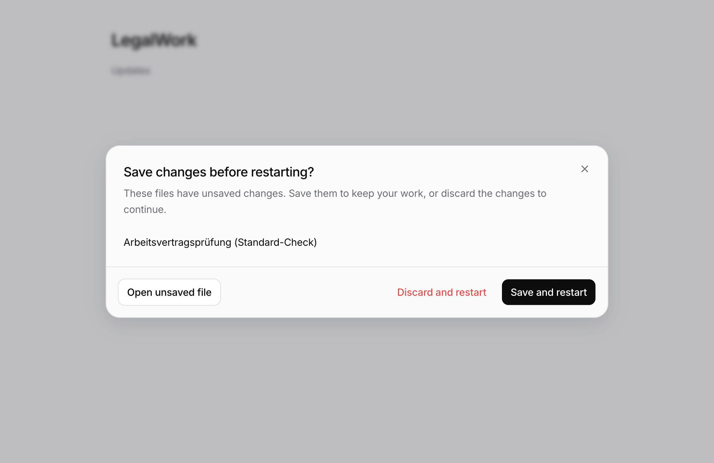

# Unsaved changes before closing or restarting

An unsaved workflow previously vetoed Electron's native close during update installation, leaving the app open without explaining why. Shutdown now asks the renderer to save, discard, or open the hidden draft before disposing services or installing the update. Normal Quit, window close, and app relaunch use the same guard.

Opening formatted workflows also produced false edits: Lexical initializes element `textFormat` and `textStyle` insertion caches, which triggered a Markdown export with normalized whitespace and list markers. The content fingerprint now ignores those caches while retaining actual text and formatting changes.

## Electron evidence

Captured on macOS with Electron 43.8.3 using the production React dialog, translations, built styles, and workflow draft store with synthetic content and persistence. The tests use isolated profiles. Native update installation is simulated; they do not install an update or touch the running development app.




All three actions remain in the bottom row; discard uses red text. The native suite also checks German labels at window widths of 640px and 440px, and hides **Open unsaved file** once the draft is in front.

## Reproduce

After `pnpm install --frozen-lockfile`, run from the repository root:

```sh
pnpm --filter @legalwork/app build
LEGALWORK_EDITOR_TEST_OUTPUT=/tmp/legalwork-workflow-editor pnpm --filter @legalwork/desktop test:workflow-editor
LEGALWORK_SHUTDOWN_TEST_OUTPUT=/tmp/legalwork-unsaved-shutdown pnpm --filter @legalwork/desktop test:shutdown
pnpm --filter @legalwork/desktop test:updater-quit
```

- Workflow editor: 9 scenarios pass, covering opening/focusing/reopening, view switching, read-only content, refresh, real typing, and formatting changes.
- Shutdown: 9 scenarios pass, including the original silent veto, hidden-draft navigation, multiple drafts, save failure, discard, narrow windows, native close, clean exit, and real `app.quit()` cancellation/save before service disposal.
- Updater quit: passes; the Electron process exits normally after disposal.

These checks also run on macOS in CI and upload their evidence as `unsaved-change-electron-evidence`.

## Other validation

- `pnpm --filter @legalwork/desktop test`: 500 pass, 4 skipped.
- `pnpm --filter @legalwork/app typecheck` and `pnpm --filter @legalwork/desktop typecheck`: pass.
- `pnpm --filter @legalwork/app build` and `pnpm --filter legalwork-server build`: pass.
- `pnpm --filter @legalwork/app test:i18n`, `node scripts/i18n-audit.mjs --ci`, `pnpm docs:generate`, and `pnpm docs:check`: pass.
- `pnpm --filter @legalwork/app test`: 2077 pass, 1 skipped, 3 Lexical initialization errors under local Bun 1.3.14: `markdown-block-editor.test.ts` (`defineExtension`) and `wiki-editor-outline.test.ts` / `wiki-title-editor.test.ts` (`getStyleObjectFromCSS$1`). All three files also fail with Lexical circular-initialization errors on the unchanged base (`IS_FIREFOX` when run together in isolation). CI uses Bun 1.4.4.

Workflow, workflow-resource, and file editors provide save/discard adapters. Existing unsaved registrations without an adapter remain protected and cannot be cleared by the shutdown dialog; finish those drafts in their original editor. Real installer replacement and Windows desktop behavior require release/platform verification.

## Email integration follow-up

After the mail branch rebase, Mac CI at `afae1d58` exposed two earlier mail quit listeners outside the guarded lifecycle. They cancelled image requests and closed attachment resources before the save decision. Mail cleanup now runs only after approval, alongside the recovery journal and owned workers. A separate completion guard keeps repeated Quit requests blocked until all cleanup finishes, even when the engine has already stopped.

The regression harness extracts every real `before-quit` registration through the existing TypeScript parser. It no longer slices from the first listener to an unrelated source marker. Headless tests execute those production listeners and verify cancellation, exactly-once cleanup and delayed recovery completion; the repeated-Quit assertion failed before the completion fix. The real Electron fixtures retain their save/cancel/discard/native-exit checks and now include the mail resources in their disposal assertions. Current-source hosted Electron results remain required; no local GUI acceptance was run for this follow-up.

Shutdown also waits for all asynchronous cleanup operations to settle. A temporary-file removal failure must not release Quit while encrypted recovery is still flushing. A headless production-listener regression reproduces the rejected-cleanup failure before this change and verifies that recovery completion still gates both the initial and repeated Quit afterward. Failures emit a fixed diagnostic without raw error details. The ten-second forced-exit deadline remains unchanged.
